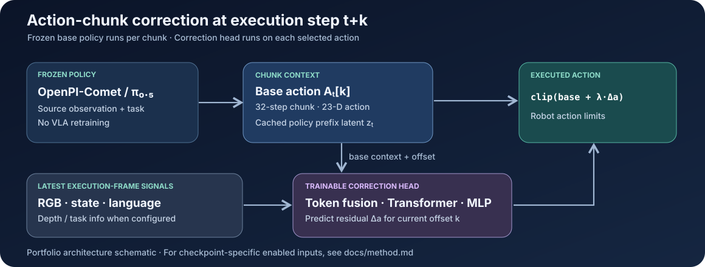

# Residual Action Chunk Correction for OpenPI-Comet

**A2C2 adaptation and closed-loop failure analysis on BEHAVIOR-1K · Task 1: Picking Up Trash**

We adapted **Asynchronous Action Chunk Correction (A2C2)** to a frozen **OpenPI-Comet / π₀.₅** vision-language-action (VLA) policy in the BEHAVIOR-1K simulator. A multimodal correction head reads the latest observation and the base policy's action chunk, then predicts a 23-dimensional residual to adjust the action being executed.

**Main finding:** lower offline action-prediction error did **not** translate to better closed-loop control. Among four correction objectives, normalized MSE performed best, but its mean final Q-score was **0.2333**, versus **0.6667** for the frozen Comet baseline (10 Task 1 evaluation instances).

> **Scope:** This repository presents our implementation and original Task 1 experiment. It is a course research project and a **negative-result analysis**, not an improvement over Comet or an official BEHAVIOR leaderboard submission.



*Architecture schematic: input availability depends on the saved checkpoint configuration.*

## What we built

- **Frozen-base integration:** extended our [OpenPI-Comet fork](https://github.com/ljc-1222/openpi-comet) to expose action chunks and the mask-pooled prefix latent from the π₀.₅ policy without retraining the VLA.
- **Aligned supervision:** built an episode-level data pipeline linking an expert action at execution time `t + k` to the base-policy action at chunk offset `k`, including valid-offset masks and stored policy latents.
- **Multimodal residual head:** implemented visual, proprioceptive, task-language, policy-latent, and time-offset features, fused through a Transformer encoder and residual MLP.
- **Closed-loop interface:** integrated a per-step correction wrapper and action-range clipping with BEHAVIOR's evaluation interface.
- **Loss and rollout analysis:** compared raw MSE, range-normalized MSE, normalized Huber, and gripper-weighted normalized Huber, together with action smoothness and clipping diagnostics.

At execution time, the head predicts a residual for the current chunk action:

$
\na_{t+k}^{\mathrm{exec}} = \operatorname{clip}\!\left(a_{t,k}^{\mathrm{base}} + \lambda\,\Delta a_{t,k}\right).
$

The base action horizon is **32 steps**, and each robot action has **23 dimensions**. Details of the token-fusion head, losses, and optional input features are in [Method](docs/method.md).

## Results: Task 1

| Policy | Mean final Q-score ↑ | Std. dev. | Instances with Q-score > 0 |
|:--|--:|--:|--:|
| **Frozen OpenPI-Comet** | **0.6667** | 0.3944 | 8/10 |
| Comet + A2C2 (raw MSE) | 0.0000 | 0.0000 | 0/10 |
| Comet + A2C2 (normalized MSE) | **0.2333** | 0.2134 | 6/10 |
| Comet + A2C2 (normalized Huber) | 0.0000 | 0.0000 | 0/10 |
| Comet + A2C2 (normalized Huber + gripper weights) | 0.1000 | 0.2134 | 2/10 |

*Original June 2026 Task 1 evaluation: 10 fixed-seed instances, correction models trained for 200k steps. **Q-score measures partial task-goal completion**, not binary success; “Q-score > 0” means some progress, not necessarily task completion. No new simulator evaluations were conducted for this documentation release.*

### What the experiments revealed

Our offline validation suggested that learned corrections could reduce the error to demonstrated actions. In the closed loop, however, every corrected variant underperformed the frozen policy. For the strongest correction variant, **normalized MSE**, measured action jerk increased from **0.040** (baseline) to **0.160**; clipping frequency alone did not explain the performance gap.

The results are consistent with several **hypotheses**, not proven causes: expert-state training versus policy-induced states, per-step residuals disrupting a coherent sampled action chunk, and the mismatch between continuous regression objectives and event-like gripper control. See [Results & analysis](docs/results.md) for measured diagnostics and the limits of this interpretation.

## Code and documentation

| Document / code | Contents |
|:--|:--|
| [Method](docs/method.md) | Architecture, latent extraction, aligned targets, and the four loss functions |
| [Results & analysis](docs/results.md) | Task 1 Q-scores, online diagnostics, and failure hypotheses |
| [Setup & usage](docs/usage.md) | Dataset, feature cache, training, offline evaluation, and online integration |
| [Integration notes](docs/integration.md) | The forked OpenPI and BEHAVIOR interfaces and their pinned commits |
| [`a2c2/src`](a2c2/src) | Residual model, datasets, losses, and online policy wrapper |
| [`a2c2/scripts`](a2c2/scripts) | Dataset export, feature conversion, training, evaluation, and websocket server |

### Project layout

```text
behavior-a2c2/
├── README.md
├── assets/                  # architecture schematic
├── docs/                    # method, results, usage, integration
├── a2c2/
│   ├── src/                 # correction head / losses / dataset / online policy
│   └── scripts/             # dataset builder / training / offline + online eval
├── openpi-comet/            # pinned submodule: patched frozen Comet policy
├── BEHAVIOR-1K/             # pinned submodule: simulator and eval integration
└── setup.sh                 # complete workspace setup
```

## Getting started

The full BEHAVIOR/OmniGibson workflow is GPU- and storage-intensive. This is a research codebase, not a one-command demo. Start with the pinned source trees:

```bash
git clone --recurse-submodules https://github.com/ljc-1222/behavior-a2c2.git
cd behavior-a2c2
bash setup.sh --skip-submodule-update --no-behavior-sparse-checkout
```

The public [A2C2 dataset repository](https://huggingface.co/datasets/ljc-1222/a2c2_dataset) contains the data artifacts; Task 1 is `picking_up_trash` (`task-0001`). The git repository does **not** bundle trained correction-head weights or rollout videos. The separate [Task 1 ablation artifact page](https://huggingface.co/ljc-1222/a2c2-task0001-ablation) is provided for reference; its individual files and media have not been independently verified in this documentation update. [Setup & usage](docs/usage.md) documents the download, optional ResNet-18 feature-cache generation, and the training/evaluation entrypoints. Full training and simulator rollout were **not** rerun as part of this presentation cleanup.

## Context, attribution, and team

This is an adaptation of **[Leave No Observation Behind: Real-time Correction for VLA Action Chunks](https://arxiv.org/abs/2509.23224)** (Sendai et al.) to **[OpenPI-Comet](https://github.com/mli0603/openpi-comet)**, Team Comet's second-place solution to the [2025 BEHAVIOR Challenge](https://behavior.stanford.edu/challenge/archive/2025/leaderboard.html). Comet's published **0.2514 held-out-test Q-score** is an aggregate challenge result across tasks and must not be compared directly to our **Task 1-only** scores above.

**Team:** Jin-Cheng Lin, Ting-Wei Lin, I-Ting Chu · Deep Learning Final Project, June 2026.

Source and assets in the two upstream forks have their own licenses and attribution. The outer repository has no separately declared license; public visibility alone does not grant redistribution rights.
