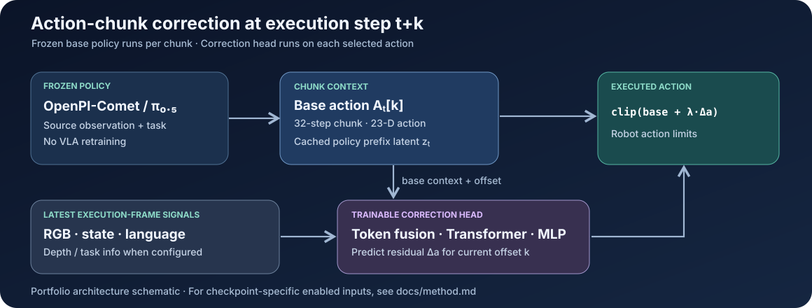

# Method

[← Project overview](../README.md) · [Results](results.md) · [Usage](usage.md)

## Motivation and execution path

OpenPI-Comet generates a chunk of **32 actions** for the R1Pro robot; each executed action contains **23 control dimensions**. A chunk can become stale while the scene changes. Following the [A2C2 method](https://arxiv.org/abs/2509.23224), we hold Comet fixed and train an auxiliary model to correct the single action selected at each execution step.

For a chunk generated at source time `t` and offset `k`:

```text
A_t, z_t = frozen_Comet(o_t, instruction)
Δa_(t,k) = correction_head(o_(t+k), A_t[k], z_t, instruction, τ(k))
a_exec   = clip(A_t[k] + λ * Δa_(t,k))
```

Here, `τ(k)` is a sinusoidal encoding of the position within the chunk; `λ` is the online correction scale (default **1.0**). Clipping occurs after residual addition. Our code implements per-step residual inference on a receding-horizon chunk; **it does not establish real-time latency guarantees or reproduce an asynchronous scheduling benchmark**.



## Training data and target alignment

`a2c2/scripts/create_dataset.py` augments BEHAVIOR expert episodes with baseline action chunks and a prefix latent:

- Each source frame `t` receives a frozen-policy chunk `A_t` with 32 actions, a valid-offset mask, and policy timing.
- A companion latent parquet stores the mask-pooled output of the COMET/PaliGemma **prefix forward pass**. This is **not** a representation from the action denoising loop.
- For each valid `(t, k)`, the execution frame is `t+k`; the supervised residual is `a_expert[t+k] - A_t[k]`.

The dataset builder preserves the original episode metadata and video modalities. The dataset loader samples valid source/offset pairs within each episode. Scripts are configured for **Task 1, `picking_up_trash`, `task-0001`** by default. The serialized model config controls which additional modalities a particular checkpoint expects.

## Correction head

The implementation in [`a2c2/src/model.py`](../a2c2/src/model.py) uses token projections followed by a **6-layer, 8-head Transformer encoder** (default hidden dimension **512**) and an MLP that regresses a **23-D residual**. Its feature groups include:

| Group | Implementation |
|:--|:--|
| Base policy | Selected base action, cached prefix latent `z_t` (2048-D), source/execution context |
| Robot | Proprioception (256-D) and chunk-offset time encoding |
| Visual | Three RGB camera views; frozen ResNet-18 features or decoded frames |
| Language | Task instruction represented by token embeddings and a GRU |
| Optional or config-dependent | Depth cameras, camera-relative poses, task-info vector, policy inference timing |

RGB and task language are required by current checkpoint validation; **depth is configurable**, not universally required. The training CLI defaults to depth, camera-relative poses, task information and inference timing enabled. Exact enabled features must be read from a saved checkpoint's configuration rather than inferred from the filename.

The frozen-base hooks live in the [OpenPI-Comet fork](https://github.com/ljc-1222/openpi-comet). [Integration notes](integration.md) identify the relevant entrypoints.

## Loss ablations

The loss implementation is in [`a2c2/src/loss.py`](../a2c2/src/loss.py). Four available `--loss-preset` values were used in the Task 1 comparison:

| Preset | Meaning |
|:--|:--|
| `raw_mse` | Ordinary mean squared residual error in the original action units |
| `norm_mse` | Per-dimension scale-normalized squared error, averaged within each of six action groups |
| `norm_huber` | Scale-normalized Huber error within each group |
| `norm_huber_gripw` | Same normalized Huber loss with double weight on the two gripper groups |

For action dimension `j`, the training-split scale is `s_j = max(Q₀.₉₉(a_j) − Q₀.₀₁(a_j), ε)`. With error `e_j = (Δâ_j − Δa*_j) / s_j`, the normalized group objective is

```text
L = Σ_(g∈groups) w_g · mean_(j∈g) ρ(e_j)
```

The six groups are base, torso, left arm, left gripper, right arm and right gripper. Defaults are Huber delta **1.0**, gripper weight **2.0** in the weighted preset, and minimum scale **1e−4**. These are **sums of group means**, not a uniform average over all 23 dimensions.

## Evaluation and interpretation

Offline evaluation measures residual, corrected-action, and base-action errors on episode data. Online evaluation runs in OmniGibson with a frozen baseline versus the residual-corrected wrapper. The local Task 1 Q-score comparison and diagnostic definitions are in [Results](results.md); a reduced offline error is not evidence of task-level improvement.

The current project documents the **observed negative result**, with possible explanations clearly separated from facts established by the experiment. No model, dataset, or simulator runs were repeated for the repository presentation.
