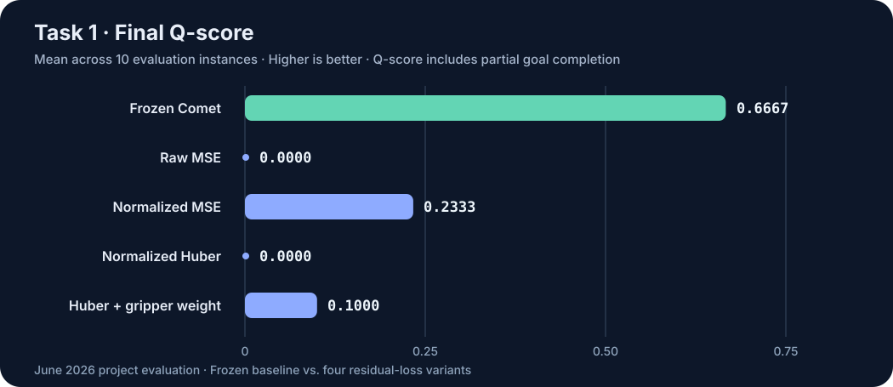

# Task 1 results and analysis

[← Project overview](../README.md) · [Method](method.md)

## Experimental setup

The project evaluated **Task 1 — Picking Up Trash** (`picking_up_trash`) on **10 fixed-seed BEHAVIOR instances**, comparing the **frozen OpenPI-Comet** policy to four A2C2 loss variants. The correction-head variants were trained for **200,000 steps**. The original project recorded the following aggregated numbers; this portfolio update did not generate any new results.

BEHAVIOR's final Q-score measures the **fraction of task-goal conditions satisfied**, permitting partial credit. “Nonzero instances” is not a count of fully completed tasks.

| Method | Final Q-score (mean) ↑ | SD | Nonzero Q-score instances |
|:--|--:|--:|--:|
| **Frozen Comet** | **0.6667** | 0.3944 | 8 / 10 |
| + A2C2, raw MSE | 0.0000 | 0.0000 | 0 / 10 |
| + A2C2, normalized MSE | 0.2333 | 0.2134 | 6 / 10 |
| + A2C2, normalized Huber | 0.0000 | 0.0000 | 0 / 10 |
| + A2C2, normalized Huber + gripper weighting | 0.1000 | 0.2134 | 2 / 10 |

**Measured outcome:** normalized MSE was the best A2C2 variant, but all correction variants underperformed the frozen baseline. The baseline's advantage here is an outcome of the **local Task 1 evaluation**, not a claim about the full 2025 challenge benchmark.

## Online action diagnostics

The original evaluation also aggregated per-step diagnostics from the BEHAVIOR wrapper.

| Policy | Mean residual L2 ↓ | Clipped action dims (%) ↓ | Gripper Acc@5 ↑ | Mean gripper delay (steps) ↓ | Action jerk norm ↓ |
|:--|--:|--:|--:|--:|--:|
| Frozen Comet | 0.000 | 4.735 | 0.713 | 510.454 | **0.040** |
| + A2C2, raw MSE | 0.383 | 9.189 | 0.000 | 178.875 | 0.269 |
| + A2C2, normalized MSE | 0.335 | 2.329 | 0.703 | 482.033 | 0.160 |
| + A2C2, normalized Huber | 0.115 | 1.695 | 0.268 | 615.282 | 0.174 |
| + A2C2, normalized Huber + gripper weighting | 0.113 | 2.357 | 0.328 | 513.311 | 0.176 |

Definitions reflect the implementation in the pinned [BEHAVIOR metrics accumulator](https://github.com/ljc-1222/BEHAVIOR-1K/blob/37a4910a2545f1d91ecf7eff45a603c420ba98c6/OmniGibson/omnigibson/learning/a2c2_online_metrics.py):

- **Residual L2:** average norm of the applied 23-D correction.
- **Clipped action dims:** percentage of action dimensions flagged by the action-range clipping mask; this is **not** the percentage of steps with any clipping.
- **Gripper Acc@5:** fraction of *matched* gripper command/realization events whose delay is at most five steps. Unmatched commands are tracked separately, so this is not an all-event success rate.
- **Gripper delay:** average steps between matched command and realization events. It is not defined as a 5-step-limited window.
- **Jerk:** mean norm of the third discrete difference of the action vector. This implementation does not divide by the control time step, so it is a discrete-action smoothness proxy rather than a physical jerk in SI units.

## Main observation

Offline corrected-action MSE was reported to improve relative to the base action predictor. Yet none of the four corrected policies matched the frozen baseline's online Q-score. In particular, **normalized MSE reduced clipping incidence compared with the baseline (2.329% versus 4.735%), but the corrected policy still had lower Q-score (0.2333 versus 0.6667)** and **4× the discrete jerk (0.160 versus 0.040)**.

This suggests that minimizing individual residual errors may be inadequate for controlling the temporal sequence that the original flow-based policy samples. It does **not** prove that jerk causes the task failures, nor that these specific variants fail across all BEHAVIOR tasks.

## Candidate explanations, not established causal findings

**Distribution shift.** The correction head is supervised on expert trajectories, while rollout corrections affect states produced by the learned policy, including errors accumulated after missed contacts or grasps.

**Temporal and multimodal inconsistency.** The frozen policy samples coherent chunks; deterministic stepwise regression toward a demonstrated action can perturb the sampled action mode or introduce discontinuities between consecutive commands.

**Action heterogeneity.** Gripper commands are event-like and bounded, whereas the MSE-family objectives treat them as continuous residuals. Range normalization and gripper weighting partially address scale but do not model event timing explicitly.

The experiment is therefore most informative as a **case study of an offline–online gap**, not as evidence of a successful A2C2 improvement.

## Evidence boundaries

These aggregated values were preserved from the original June 2026 project results. The repository does not currently distribute the per-instance rollout JSONs, trained checkpoints, or an exact replay package, and no new training/evaluation was performed for this documentation revision. The tables are historical experimental records, not freshly reproduced measurements.

The [2025 Comet result](https://behavior.stanford.edu/challenge/archive/2025/leaderboard.html) (second place, 0.2514 held-out-test Q-score) is **a separate challenge-wide result** and is not directly comparable to our Task 1-only scores.
